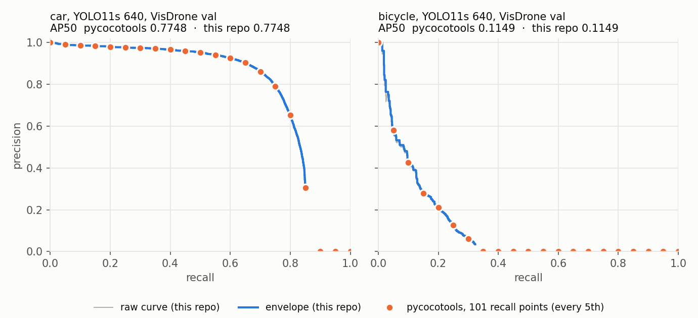

# detection-eval

English · [Türkçe](README.tr.md)

Object detection evaluation written from scratch (IoU, matching, AP, COCO-style mAP, NMS)
and checked against pycocotools, then used to answer one question on a real model:

**Same model, same images: how much mAP do you get depending on who measures it, and why?**

The model is YOLO11s trained on [VisDrone2019-DET](https://github.com/VisDrone/VisDrone-Dataset)
(drone images, 10 classes, many objects under 32 pixels) at 640 and 1280. Training, ONNX Runtime
inference and the full results per class and object size are in
[aerial-object-detection](https://github.com/tanirim/aerial-object-detection), which uses this
repo for every number it reports.

## Results

`best.pt` of each run, selected on val. Two splits: val (548 images, 38,759 objects) and
test-dev (1,610 images, 75,102 objects), which was not used for training or model selection.

| split | mAP | measured by | imgsz 640 | imgsz 1280 |
|---|---|---|---|---|
| val | mAP50 | Ultralytics `yolo val` | 0.380 | 0.547 |
| val | mAP50 | pycocotools | 0.347 | 0.503 |
| val | mAP50 | **this repo** | **0.347** | **0.503** |
| test-dev | mAP50 | pycocotools | 0.288 | 0.411 |
| test-dev | mAP50 | **this repo** | **0.288** | **0.411** |
| val | mAP50-95 | Ultralytics `yolo val` | 0.222 | 0.335 |
| val | mAP50-95 | pycocotools | 0.207 | 0.315 |
| test-dev | mAP50-95 | pycocotools | 0.169 | 0.246 |

- **This repo equals pycocotools.** AP50 is the same in every class, at both sizes, on both
  splits; the largest difference is 2.2e-16 (floating point rounding). The test suite also
  compares the two on random data with tied scores and small `maxDets`.
- **Who measures:** on val, Ultralytics reports 0.033 (640) and 0.044 (1280) more mAP50 than
  pycocotools from the same weights. The known differences are listed below; how much
  each one contributes is not measured yet.
- **Which images:** test-dev is 0.06 (640) and 0.09 (1280) mAP50 lower than val. It is not the
  detection limit (raising `maxDets` to 1000 adds 0.002) and not crowding (46.6 objects per image
  vs 70.7 on val): the test-dev scenes are harder for this model, people and pedestrians most of all.

### Why Ultralytics Reports More

From the Ultralytics 8.4.175 source:

- **Matching order.** pycocotools matches detections from the highest score down. Ultralytics
  matches by IoU, highest IoU first.
- **AP at 101 points.** pycocotools reads the precision envelope as a step function
  (`searchsorted`). Ultralytics interpolates linearly (`np.interp`) and integrates with
  `np.trapezoid`.
- **Inference path.** `yolo val` runs batched with rectangular letterboxing and FP16;
  the detections scored here come from `predict`, one image at a time.
- **Not the cause:** detection limits. pycocotools keeps 100 detections per image and class;
  raising it to 1000 changes mAP50 at 640 from 0.347 to 0.348.

### Precision-Recall Curves



Val, imgsz 640, IoU 0.50. Blue: the precision envelope from this repo; orange: the precision
pycocotools stores at its 101 recall thresholds (every 5th shown). Every orange point sits on
the blue line. Past the highest recall the model reaches (0.85 for car, 0.32 for bicycle),
pycocotools counts precision as 0. For bicycle that is two thirds of the 101 points, on top of
a precision that falls below 0.6 within the first 5% of recall. Drawn with
`scripts/plot_pr_curve.py`.

## How It Works

```
src/detection_eval/
  boxes.py      box format conversions, pairwise IoU (NumPy broadcasting)
  matching.py   greedy score-ordered matching, precision / recall
  ap.py         precision-recall curve, AP (all points and COCO 101-point), mAP
  coco.py       YOLO labels and detections -> COCO JSON
  evaluate.py   COCO-style mAP50 per class from the pieces above
  nms.py        NMS and class-aware NMS
scripts/
  eval_coco.py       ground truth from YOLO labels, pycocotools and this repo side by side
  plot_pr_curve.py   precision-recall curves, this repo and pycocotools on one plot
  draw_matches.py    draw TP / FP / missed boxes on one image
```

Per class, the same steps as pycocotools: in each image sort detections by score (stable sort,
ties keep input order) and keep the top 100, match them to that image's ground truth, put all
images into one list, build one precision-recall curve and average the precision envelope at
101 recall thresholds.

## Usage

Requires [uv](https://docs.astral.sh/uv/).

```bash
uv sync                  # numpy, pillow, pyyaml + pycocotools, pytest
uv run pytest -q         # 86 tests
```

Any YOLO-format dataset with an Ultralytics data YAML works. Detections are a COCO results JSON
(`image_id` = position of the image in the sorted file list, starting at 1; `category_id` =
YOLO class + 1):

```bash
uv run python scripts/eval_coco.py --data data/VisDrone.yaml --detections runs/yolo11s_640_val/detections.json
uv run python scripts/draw_matches.py --run runs/yolo11s_640_val --images data/VisDrone/images/val
```

`eval_coco.py` writes `ground_truth.json` next to the detections; add `--split test` for another
split. The plot needs matplotlib (`uv sync --group plot`):

```bash
uv run --group plot python scripts/plot_pr_curve.py --data data/VisDrone.yaml \
    --detections runs/yolo11s_640_val/detections.json --classes car bicycle --out docs/pr_curve.png
```

As a library:

```python
from detection_eval.coco import labels_to_coco, read_yolo_dataset
from detection_eval.evaluate import coco_map50

gt = labels_to_coco(read_yolo_dataset("images/val", "labels/val"), class_names)
map50, ap_per_class = coco_map50(gt, detections)
```

## Limitations

- **Ignored regions.** VisDrone marks some areas as "ignored". The Ultralytics converter drops
  them, so detections there count as false positives in every row of the table above.
- **One seed per run.** Differences below about 0.005 mAP may be noise.
- **Ultralytics on test-dev not run.** The "who measures" gap is shown on val only.

## Next

- Split the Ultralytics / pycocotools gap into its parts.
- Ignored regions as crowd boxes.
- Soft-NMS, then a C++ NMS with a benchmark.
- Error analysis: classification, localisation, duplicate, background and missed errors.

## License

Code: MIT. VisDrone is licensed for academic use only and is not part of this repository.
