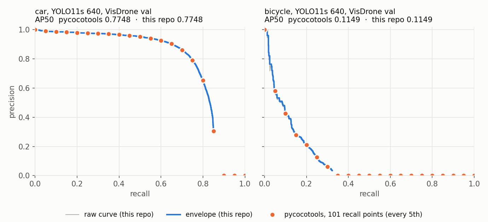

# detection-eval

[English](README.md) · Türkçe

Sıfırdan yazılmış nesne tespiti değerlendirmesi (IoU, eşleştirme, AP, COCO tarzı mAP, NMS).
Sonuçlar pycocotools ile karşılaştırılarak doğrulandı, ardından gerçek bir modelde tek bir soruyu
cevaplamak için kullanıldı:

**Aynı model, aynı görüntüler: kimin ölçtüğüne göre kaç mAP çıkıyor ve neden?**

Model, [VisDrone2019-DET](https://github.com/VisDrone/VisDrone-Dataset) üzerinde (dron görüntüleri,
10 sınıf, çoğu 32 pikselden küçük nesneler) 640 ve 1280 giriş boyutuyla eğitilen YOLO11s. Eğitim,
ONNX Runtime ile çalıştırma ve sınıf ile nesne boyutuna göre tüm sonuçlar
[aerial-object-detection](https://github.com/tanirim/aerial-object-detection) reposunda. O repo
verdiği her sayıyı bu repoyla ölçüyor.

## Sonuçlar

Her eğitimin val'e göre seçilen `best.pt` ağırlıkları. İki bölüm: val (548 görüntü, 38.759 nesne)
ve eğitimde ya da model seçiminde hiç kullanılmayan test-dev (1.610 görüntü, 75.102 nesne).

| bölüm | mAP | ölçen | imgsz 640 | imgsz 1280 |
|---|---|---|---|---|
| val | mAP50 | Ultralytics `yolo val` | 0.380 | 0.547 |
| val | mAP50 | pycocotools | 0.347 | 0.503 |
| val | mAP50 | **bu repo** | **0.347** | **0.503** |
| test-dev | mAP50 | pycocotools | 0.288 | 0.411 |
| test-dev | mAP50 | **bu repo** | **0.288** | **0.411** |
| val | mAP50-95 | Ultralytics `yolo val` | 0.222 | 0.335 |
| val | mAP50-95 | pycocotools | 0.207 | 0.315 |
| test-dev | mAP50-95 | pycocotools | 0.169 | 0.246 |

- **Bu repo pycocotools ile aynı sonucu veriyor.** AP50 her sınıfta, iki boyutta ve iki bölümde
  aynı; en büyük fark 2.2e-16 (kayan nokta yuvarlaması). Testler ikisini ayrıca eşit skorlu ve
  küçük `maxDets`'li rastgele veride de karşılaştırıyor.
- **Kim ölçüyor:** val'de Ultralytics, aynı ağırlıklar için pycocotools'tan 0.033 (640) ve
  0.044 (1280) daha yüksek mAP50 veriyor. Bilinen farklar aşağıda; her birinin payı henüz
  ölçülmedi.
- **Hangi görüntüler:** test-dev, val'den 0.06 (640) ve 0.09 (1280) mAP50 daha düşük. Sebep
  tespit sınırı değil (`maxDets`'i 1000'e çıkarmak 0.002 ekliyor), kalabalık da değil (görüntü
  başına 46.6 nesne, val'de 70.7): test-dev sahneleri bu model için daha zor, en çok da people ve
  pedestrian sınıflarında.

### Ultralytics Neden Daha Yüksek Gösteriyor

Ultralytics 8.4.175 kaynak kodundan:

- **Eşleştirme sırası.** pycocotools tespitleri en yüksek skordan başlayarak eşleştiriyor.
  Ultralytics IoU sırasıyla, en yüksek IoU'dan başlayarak eşleştiriyor.
- **101 noktada AP.** pycocotools precision zarfını basamak fonksiyonu gibi okuyor
  (`searchsorted`). Ultralytics doğrusal ara değer buluyor (`np.interp`) ve `np.trapezoid` ile
  alan hesaplıyor.
- **Çıkarım yolu.** `yolo val` toplu (batch) çalışıyor, dikdörtgen letterbox ve FP16
  kullanıyor; burada ölçülen tespitler ise `predict` ile tek tek görüntüden geliyor.
- **Sebep olmayan:** tespit sınırı. pycocotools görüntü ve sınıf başına 100 tespit tutuyor;
  bunu 1000'e çıkarmak 640'ta mAP50'yi 0.347'den 0.348'e değiştiriyor.

### Precision-Recall Eğrileri



Val, imgsz 640, IoU 0.50. Mavi: bu reponun hesapladığı precision zarfı; turuncu: pycocotools'un
101 recall eşiğinde sakladığı precision (her 5. nokta gösteriliyor). Her turuncu nokta mavi
çizginin üstünde. Modelin ulaştığı en yüksek recall'un ötesinde (car için 0.85, bicycle için
0.32) pycocotools precision'ı 0 sayıyor. Bicycle'da bu, 101 noktanın üçte ikisi; üstelik
precision recall'un ilk %5'inde 0.6'nın altına iniyor. Çizim: `scripts/plot_pr_curve.py`.

## Nasıl Çalışıyor

```
src/detection_eval/
  boxes.py      kutu formatı dönüşümleri, ikili IoU (NumPy broadcasting)
  matching.py   skora göre açgözlü eşleştirme, precision / recall
  ap.py         precision-recall eğrisi, AP (tüm noktalar ve COCO 101 nokta), mAP
  coco.py       YOLO etiketleri ve tespitler -> COCO JSON
  evaluate.py   yukarıdaki parçalardan sınıf başına COCO tarzı mAP50
  nms.py        NMS ve sınıfa duyarlı NMS
scripts/
  eval_coco.py       YOLO etiketlerinden gerçek kutular, pycocotools ve bu repo yan yana
  plot_pr_curve.py   precision-recall eğrileri, bu repo ve pycocotools aynı grafikte
  draw_matches.py    bir görüntüde TP / FP / kaçan kutuları çizer
```

Her sınıf için pycocotools ile aynı adımlar: her görüntüde tespitleri skora göre sırala (kararlı
sıralama, eşit skorlar giriş sırasını korur) ve en yüksek 100'ü tut, o görüntünün gerçek
kutularıyla eşleştir, tüm görüntüleri tek listede birleştir, tek bir precision-recall eğrisi kur
ve precision zarfının 101 recall eşiğindeki ortalamasını al.

## Kullanım

[uv](https://docs.astral.sh/uv/) gerekir.

```bash
uv sync                  # numpy, pillow, pyyaml + pycocotools, pytest
uv run pytest -q         # 87 test
```

Ultralytics data YAML'ı olan her YOLO formatlı veri setiyle çalışır. Tespitler bir COCO results
JSON dosyasıdır (`image_id` = görüntünün sıralı dosya listesindeki yeri, 1'den başlar;
`category_id` = YOLO sınıfı + 1):

```bash
uv run python scripts/eval_coco.py --data data/VisDrone.yaml --detections runs/yolo11s_640_val/detections.json
uv run python scripts/draw_matches.py --run runs/yolo11s_640_val --images data/VisDrone/images/val
```

`eval_coco.py`, `ground_truth.json` dosyasını tespitlerin yanına yazar; başka bir bölüm için
`--split test` ekle. Grafik için matplotlib gerekir (`uv sync --group plot`):

```bash
uv run --group plot python scripts/plot_pr_curve.py --data data/VisDrone.yaml \
    --detections runs/yolo11s_640_val/detections.json --classes car bicycle --out docs/pr_curve.png
```

Kütüphane olarak:

```python
from detection_eval.coco import labels_to_coco, read_yolo_dataset
from detection_eval.evaluate import coco_map50

gt = labels_to_coco(read_yolo_dataset("images/val", "labels/val"), class_names)
map50, ap_per_class = coco_map50(gt, detections)
```

## Sınırlar

- **Yok sayılan bölgeler.** VisDrone bazı alanları "yok say" diye işaretliyor. Ultralytics'in
  dönüştürücüsü bunları siliyor, bu yüzden oradaki tespitler yukarıdaki tablonun her satırında
  yanlış pozitif sayılıyor.
- **Her eğitim tek seed.** Yaklaşık 0.005 mAP'den küçük farklar gürültü olabilir.
- **Ultralytics test-dev'de çalıştırılmadı.** "Kim ölçüyor" farkı sadece val'de gösteriliyor.

## Sırada

- Ultralytics / pycocotools farkını parçalarına ayırmak.
- Yok sayılan bölgeleri crowd kutusu olarak işlemek.
- Soft-NMS, ardından C++ NMS ve hız karşılaştırması.
- Hata analizi: sınıflandırma, konum, tekrar, arka plan ve kaçan nesne hataları.

## Lisans

Kod: MIT. VisDrone yalnızca akademik kullanım için lisanslı ve bu repoda yer almıyor.
